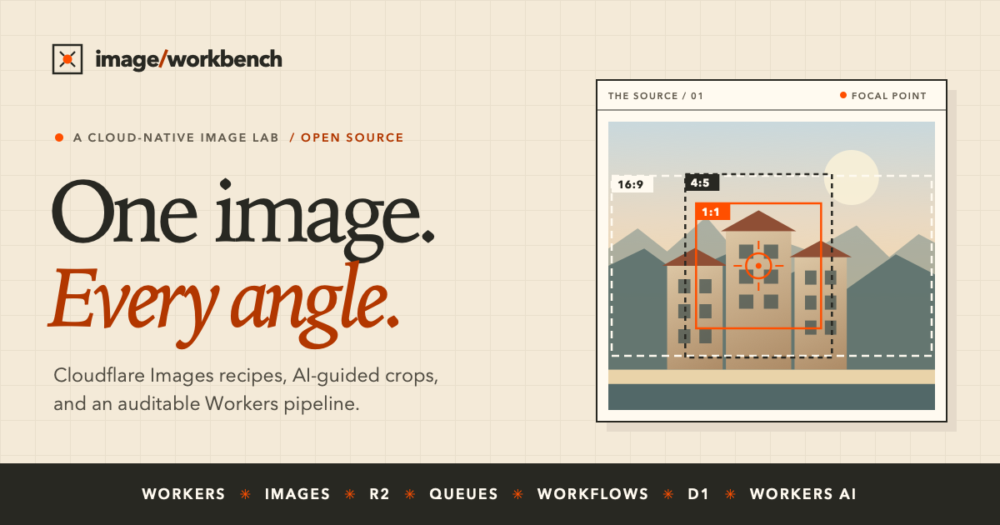
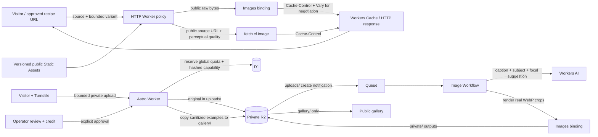

# Image Workbench

[](https://deploy.workers.cloudflare.com/?url=https://github.com/Gryczka/cloudflare-image-workbench)
[](https://github.com/Gryczka/cloudflare-image-workbench/actions/workflows/ci.yml)
[](LICENSE)

> Run real Cloudflare Images recipes, follow a private upload through Queues, Workflows, and Workers AI, and inspect the exact code and run record behind every result.

**[Live demo](https://cloudflare-image-workbench.dwarven.workers.dev/)**



Explore bounded, public recipes for resize, framing, format, effects, overlays, and responsive delivery. Every sample reveals its **actual Cloudflare Images result**, architecture, extracted server source, resolved parameters, and observed run metadata. Then follow the separate, private upload → Queue → Workflow path for pre-generated crops, AI-assisted editing, and clearly labeled synthetic illustrations. An upload becomes public only if its owner opts into the gallery with a credit and an operator then approves it.

**Status:** A reference implementation shared as-is, with best-effort support through [GitHub Issues](https://github.com/Gryczka/cloudflare-image-workbench/issues). It is not actively maintained.

## Contents

- [How it works](#how-it-works)
- [Features](#features)
- [Tech stack](#tech-stack)
- [Getting started](#getting-started)
- [Configuration](#configuration)
- [Deploy your own copy](#deploy-your-own-copy)
- [Staging and production](#staging-and-production)
- [Operating the gallery](#operating-the-gallery)
- [Privacy and retention](#privacy-and-retention)
- [Demo limits](#demo-limits)
- [Synthetic art direction](#synthetic-art-direction)
- [Project structure](#project-structure)
- [Sample photography and attribution](#sample-photography-and-attribution)
- [Contributing and license](#contributing-and-license)

## How it works



One Worker serves two paths. **Request-time recipes** transform a small set of versioned public sources and cache the response; visitor uploads are never their input. **Upload-time processing** is private and durable: an R2 event notification feeds a Queue, a Workflow renders each crop once, and the stored results are served instead of being recomputed. Astro prerenders the landing page; recipes, uploads, the gallery, and the operator API are dynamic routes in the same Worker, which also consumes the Queue and runs an hourly cleanup Cron Trigger.

The nine sample families fall under **Image transformations**, **Delivery and orchestration**, and **AI-assisted workflows**. Public samples use a small, attributed set of versioned sources, not uploaded originals. Supported source/variant/point selections are registered in [`src/showcases/catalog.ts`](./src/showcases/catalog.ts) and resolved by [`src/showcases/recipes.ts`](./src/showcases/recipes.ts). The Worker executes those plans through [`src/showcases/execute.ts`](./src/showcases/execute.ts). Its source excerpts are extracted from the deployed files and checked during the build. The inspector reports actual output dimensions/bytes/MIME, build-verified original byte counts, the recipe/source versions, request headers, and **real** cache status when reported. A Worker-cache hit reuses the previous response; its timestamp or image-operation duration does not describe a new transformation. Browser elapsed time and image-operation time are not billed Worker CPU.

The perceptual WebP sample requests a named quality level through [the `cf.image` fetch option](https://developers.cloudflare.com/images/optimization/transformations/transform-via-workers/) on a public static source, demonstrating URL-based transformation alongside the binding; its inspector labels that path. Private originals and all other public recipes use the raw-byte Images binding. A `cf.image` subrequest can reuse its own resized-image cache even when the Worker's response cache reports a miss.

### AI editorial assistance

Moondream 3.1 works from an in-memory JPEG of the sanitized preview: its caption skill drafts the caption, short questions draft alt text and a subject, and it points at a visible human face or, failing that, the most prominent object for a normalized focal point. Every Moondream call sets `stream: false`; without it, the binding currently replies with an event stream, and point requests fail. If Moondream returns an error or no usable caption, Llama 4 Scout can supply an **identified, editable fallback** draft and estimated focal point; the result is marked partial, and its note says which failure occurred. A focal point at the exact image center is discarded because it would duplicate the center crop. Center and automatic-gravity crops are still produced if vision inference is unavailable. Each analysis logs per-model outcomes and bounded error summaries, never captions or image data. Neither model's text should be published as an unchecked factual claim.

## Features

- **Nine inspectable sample families:** resize, fit, and crop; smart and focal framing; format and quality; effects and their order; watermarks and text; adaptive delivery; and three Workflow-backed samples. Each shows the real output, resolved parameters, extracted server source, and cache status.
- **A private upload pipeline:** Turnstile-gated, size- and pixel-bounded uploads flow from R2 through a Queue to a Workflow that renders nine WebP crops: center, automatic, and AI-guided framing for three presets.
- **AI editorial drafts:** a vision model suggests a caption, alt text, and focal point that an editor can change; Images, not the model, performs every crop.
- **Clearly labeled synthetic illustrations:** at most one per upload, generated from a sanitized reference, never retried after a billed failure, and kept apart from editorial crops.
- **A consent-first gallery:** uploaders opt in with a credit, an operator approves each example, and a takedown unpublishes it and purges its cache tag.
- **Enforced retention:** private links last 24 hours; the original is deleted after processing; an hourly cleanup and R2 lifecycle rules remove the rest.
- **Recorded provenance:** each derivative stores the generation-time code snapshot, resolved transform, model identities, and observed sizes.
- **Cost and abuse controls:** atomic global quotas in D1, daily per-network allowances stored as salted hashes, and Workers rate-limit bindings.

## Tech stack

| Layer          | Technology                                                                         |
| -------------- | ---------------------------------------------------------------------------------- |
| Framework      | Astro 7 with `@astrojs/cloudflare`: a prerendered page and dynamic API routes      |
| Runtime        | Cloudflare Workers, Static Assets, Workers Cache, Cron Triggers                    |
| Images         | Cloudflare Images binding; `fetch` with `cf.image` for one recipe                  |
| Storage        | R2 for originals, derivatives, and the gallery; D1 for uploads, quotas, and review |
| Orchestration  | R2 event notifications, Queues, Workflows                                          |
| AI             | Workers AI: Moondream 3.1, Llama 4 Scout, FLUX.2 [klein] 9B                        |
| Abuse controls | Turnstile, Workers rate-limit bindings                                             |
| Tooling        | TypeScript, Vitest with `@cloudflare/vitest-plugin`, ESLint, Prettier, Wrangler 4  |

## Getting started

Requires Node.js 22.22.3+, 24.16+, or 26.3+ and a Cloudflare account. Log in with `npx wrangler login`: the Workers AI binding is always remote, even during local development. Images, Workers AI, and hosted storage may incur usage charges; consult the [current product pricing](https://developers.cloudflare.com/workers/platform/pricing/) for your account.

```sh
git clone https://github.com/Gryczka/cloudflare-image-workbench.git
cd cloudflare-image-workbench
npm ci
cp .dev.vars.example .dev.vars # optional: secrets for local uploads and the operator API
npm run db:migrate:local
npm run dev
```

Use `npm run check` for lint, Workers-runtime tests, Astro diagnostics, browser-script typechecking, verified demo-asset hashes/source markers, and a production build. `npm run preview` builds and serves locally through Wrangler. Wrangler uses a local, low-fidelity Images implementation; test face gravity, effects, text, and encoding on a deployed Worker. Public uploads start **paused** everywhere, but the attributed public sample recipes remain usable. For a full local upload, configure a real Turnstile widget/secret for your local hostname; the Worker checks the token's `success`, `action`, and **exact request hostname**. R2 event notifications do not run in the local simulator, so the default configuration starts each upload's Workflow directly (`START_WORKFLOW_ON_UPLOAD`).

## Configuration

[`wrangler.jsonc`](./wrangler.jsonc) has three configurations. Its top level is the default for local development and Deploy to Cloudflare; `staging` and `production` are the hosted demo's environments.

| Name                       | Kind           | Default                                       | Purpose                                                                                                             |
| -------------------------- | -------------- | --------------------------------------------- | ------------------------------------------------------------------------------------------------------------------- |
| `PUBLIC_UPLOADS_ENABLED`   | var            | `"false"`                                     | Opens the upload and creative routes when `"true"` and both Turnstile values are set.                               |
| `TURNSTILE_SITE_KEY`       | var            | `""`                                          | Public site key of a Turnstile widget for your hostname.                                                            |
| `TURNSTILE_SECRET`         | secret         | unset                                         | Secret key of the same widget. The Worker checks each token's `success`, `action`, and exact hostname.              |
| `ADMIN_REVIEW_TOKEN`       | secret         | unset                                         | Operator token for `/api/admin/*`: 32–128 characters of `A–Z a–z 0–9 _ -`. Generate it with `openssl rand -hex 32`. |
| `MEDIA_BUCKET_NAME`        | var            | `image-workbench-media`                       | Must equal the `MEDIA` bucket's name. The Queue consumer ignores events from any other bucket.                      |
| `START_WORKFLOW_ON_UPLOAD` | var            | `"true"`; `"false"` in staging and production | Starts processing from the upload route, so uploads work before an R2 event notification exists.                    |
| `SITE_URL`                 | build variable | unset                                         | Public origin for canonical and Open Graph URLs, which are omitted when it is unset.                                |
| `CLOUDFLARE_ENV`           | build variable | unset                                         | Selects the Wrangler environment (`staging` or `production`) at build time.                                         |

Locally, secrets come from `.dev.vars` (see [`.dev.vars.example`](./.dev.vars.example)); deployed Workers use `npx wrangler secret put`. Never put a secret in `wrangler.jsonc`.

| Binding                                | Type           | Used for                                                                        |
| -------------------------------------- | -------------- | ------------------------------------------------------------------------------- |
| `IMAGES`                               | Images         | Recipes, previews, crops, and output encoding                                   |
| `MEDIA`                                | R2             | Private originals and derivatives, and the retained `gallery/` prefix           |
| `DB`                                   | D1             | Uploads, quotas, per-network allowances, and gallery records                    |
| `PROCESS_IMAGE`                        | Workflow       | Editorial and creative processing                                               |
| `UPLOAD_EVENTS`                        | Queue producer | Declares the queue so that Wrangler can create it; R2 is the only real producer |
| `AI`                                   | Workers AI     | Vision drafts and synthetic illustrations                                       |
| `ASSETS`                               | Static Assets  | The prerendered page and the versioned demo sources                             |
| `UPLOAD_THROTTLE`, `SHOWCASE_THROTTLE` | Rate limiting  | Upload, operator-authentication, and recipe throttles                           |

Links on the page come from [`src/lib/site.ts`](./src/lib/site.ts). In a fork, point `REPOSITORY_URL` at your repository (removal requests open issues there) and set `GARDEN_URL` and the docs attribution to `null`. On macOS, `swift scripts/og-image.swift` regenerates the Open Graph card.

## Deploy your own copy

The **Deploy to Cloudflare** button above copies this repository into your GitHub or GitLab account, creates the Worker, R2 bucket, D1 database, and Queue from the top level of `wrangler.jsonc`, applies the D1 migrations (`npm run deploy`), and deploys to `workers.dev`. The public recipes work immediately; visitor uploads stay **paused**. It prompts for `TURNSTILE_SECRET` and `ADMIN_REVIEW_TOKEN`, which can stay blank until you enable uploads. To emit canonical and Open Graph URLs, set a `SITE_URL` build variable (your public origin, such as `https://image-workbench.<subdomain>.workers.dev`) in the Worker's build settings. `robots.txt` and `sitemap.xml` use the serving hostname either way.

To deploy the same configuration by hand, log in with `npx wrangler login`, create the database once with `npx wrangler d1 create image-workbench-db` (Wrangler creates the bucket and queue on deploy), then run `npm run build && npm run deploy`. `UPLOAD_EVENTS` is a producer binding the Worker never sends to: R2 notifications are the queue's only producer, but Wrangler only creates a missing queue that a producer declares.

### Enable visitor uploads

Uploads cost Workers AI, Images, and R2 usage, and they make you the operator of what visitors submit. Before turning them on:

1. Create a Turnstile **managed** widget for your Worker's hostname. Put its public site key in `TURNSTILE_SITE_KEY` under `vars` in your copy of `wrangler.jsonc` (vars set only in the dashboard are replaced on the next deploy), and store the secret with `npx wrangler secret put TURNSTILE_SECRET`.
2. Store an operator token with `npx wrangler secret put ADMIN_REVIEW_TOKEN`; generate it with `openssl rand -hex 32`. A base64 value containing `+`, `/`, or `=` is rejected and logged as `admin_token_misconfigured`.
3. Add the R2 lifecycle rules that back up the hourly cleanup:

   ```sh
   npx wrangler r2 bucket lifecycle add image-workbench-media expire-originals uploads/ --expire-days 1
   npx wrangler r2 bucket lifecycle add image-workbench-media expire-private private/ --expire-days 1
   ```

4. Optionally route uploads through the Queue, as the hosted demo does: add `npx wrangler r2 bucket notification create image-workbench-media --event-types object-create --prefix uploads/ --queue image-workbench-events`, then set `START_WORKFLOW_ON_UPLOAD` to `"false"`. Leaving it `"true"` alongside a notification is safe, because the Workflow ID is deterministic.
5. If you deploy more than one copy in the same account, give each its own rate-limit `namespace_id` values; Workers that share an ID share its counters.
6. Point `REPOSITORY_URL` in `src/lib/site.ts` at a repository whose issues you monitor, because the privacy section sends removal requests there.
7. Set `PUBLIC_UPLOADS_ENABLED` to `"true"`, deploy, and run one real upload end to end.

## Staging and production

The hosted demo uses the `staging` and `production` environments in `wrangler.jsonc`. Each needs its **own** R2 bucket, Queue, D1 database, Worker, and Workflow; rename them if they conflict with resources in your account. Never add account IDs or API tokens to source. First-time setup for staging:

```sh
npx wrangler r2 bucket create image-workbench-staging-media
npx wrangler queues create image-workbench-staging-events
npx wrangler d1 create image-workbench-staging-db
npx wrangler r2 bucket notification create image-workbench-staging-media \
  --event-types object-create --prefix uploads/ --queue image-workbench-staging-events
npx wrangler r2 bucket lifecycle add image-workbench-staging-media expire-originals uploads/ --expire-days 1
npx wrangler r2 bucket lifecycle add image-workbench-staging-media expire-private private/ --expire-days 1
```

Then deploy with `DEPLOY_URL=https://<worker>.<subdomain>.workers.dev npm run deploy:staging` (or `deploy:production`). [The deploy script](./scripts/deploy-environment.mjs) runs `npm run check` with `CLOUDFLARE_ENV` set, confirms the build targets that environment and that production keeps preview URLs off, and confirms the bucket's lifecycle rules and, unless `START_WORKFLOW_ON_UPLOAD` is `"true"`, its Queue notification. It then applies the D1 migrations, deploys, and verifies `/health`, the page, `/api/config`, `/api/gallery`, `robots.txt`, a live recipe transform, and that security headers match [`public/_headers`](./public/_headers). Production builds set `SITE_URL` to `DEPLOY_URL`, and the script checks the canonical link. Wrangler is the only step that receives your credentials.

Astro selects the Wrangler environment at **build** time, so `CLOUDFLARE_ENV` must be set for the build as well as the deploy; building the default environment and then running `wrangler deploy --env staging` deploys the wrong Worker. Production serves from `workers.dev` with preview URLs disabled. To use a custom domain instead, add it under `env.production` (`routes` with `custom_domain: true`) and set `workers_dev` to `false`.

Notification and lifecycle rules are **separate bucket settings** that a deploy never creates; inspect them with `npx wrangler r2 bucket notification list <bucket>` and `npx wrangler r2 bucket lifecycle list <bucket>`. Apply D1 migrations **before** deploying code that depends on them, as both deploy paths do. The Queue consumer validates the event kind, bucket, exact object key, and matching D1 row, and ignores writes to `private/` and `gallery/`, so transformed images cannot re-trigger ingestion. Staging and production set `START_WORKFLOW_ON_UPLOAD` to `"false"` so that they exercise the notification → Queue → Workflow path.

Create a Turnstile **managed** widget for each environment's hostname, put its public site key in that environment's `TURNSTILE_SITE_KEY`, and store its secret and an operator token with `npx wrangler secret put TURNSTILE_SECRET --env <environment>` and `npx wrangler secret put ADMIN_REVIEW_TOKEN --env <environment>`. Keep `PUBLIC_UPLOADS_ENABLED` set to `"false"` until real-token and replay tests, the Queue → Workflow → Images path, quotas, and expiry checks pass, and set it to `"true"` only in an environment you are ready to operate.

## Operating the gallery

The gallery is empty until an operator publishes a credited example. An operator uses `GET /api/admin/review` with `Authorization: Bearer <ADMIN_REVIEW_TOKEN>` to list unexpired uploads whose owners opted into the gallery, with each owner's credit; `GET /api/admin/review/<id>/preview` returns a private preview. `POST /api/admin/review` accepts JSON with `id`, `title`, `credit` (must match the uploader's credit exactly), `caption` and `altText` (written or confirmed by the operator, because AI drafts are never published by default), and `includeCreative` (default `false`). It copies only sanitized WebP assets to the gallery under a new random ID, then marks the row published; visitor uploads never enter the public gallery automatically.

`DELETE /api/admin/gallery/<id>` withdraws a published example. It unpublishes the row, deletes the `gallery/<id>/` objects, and purges the `gallery-<id>` cache tag. If the purge fails, it returns `503` and is safe to retry. Gallery images tell browsers to revalidate after 60 seconds, while the edge keeps them for up to a day until purged. Failed operator authentication is throttled per network.

## Privacy and retention

The original is never served publicly. Each private result requires a random bearer capability, whose **hash**, not the token, is stored in D1. The result API denies access after 24 hours. The Workflow deletes the original once processing succeeds. An hourly Cron Trigger deletes each expired upload's remaining `uploads/` and `private/` objects, then its D1 row; R2 lifecycle rules on both prefixes are a one-day backstop. Workflow instances use one-day success and error retention, and derivative writes re-check expiry so a late step cannot recreate deleted bytes. Approved examples are copied to a retained `gallery/` prefix under a new random ID. Synthetic images stay separate from editorial crops and carry an explicit provenance label and response header.

For new jobs, the Workflow stores a sanitized generation-time code snapshot, source identity, resolved transform, actual R2 object sizes, completed steps, and explicit model identities with each derivative. Curator-approved examples copy a provenance snapshot without the private original's object path, SHA-256, or byte size, and with timestamps reduced to the day. Older images without a recorded snapshot are labeled **history unavailable**; the current source is never represented as their executed code. Switching crop tabs retrieves a stored R2 object, not another transformation.

The page's privacy section tells visitors what is processed and by which models, how long it is kept, that the operator can view uploads for moderation, and that the gallery is opt-in. Its removal link opens an issue in this repository, asking for the example's title rather than the image.

## Demo limits

| Boundary                | Default                                                             |
| ----------------------- | ------------------------------------------------------------------- |
| Upload                  | JPEG, PNG, or WebP; ≤5 MB and ≤16 megapixels, verified by Images    |
| Global upload budget    | 8/day and 120/month (atomic D1 reservation)                         |
| Per-client uploads      | 3/day per network (IPv4 address or IPv6 /64)                        |
| Global synthetic budget | 2/day and 10/month; at most one per private upload                  |
| Per-client synthetic    | 1/day per network                                                   |
| Local network throttle  | 6 attempts per 60 seconds (Workers rate-limit binding)              |
| Public recipe throttle  | 60 uncached attempts per 60 seconds per client (rate-limit binding) |
| Operator auth failures  | 6 per 60 seconds per network, then `429`                            |
| Private results         | Capability-gated, served for at most 24 hours                       |

The rate-limit binding is a local abuse throttle; D1 is the authoritative global cap. Per-client allowances store only a salted hash of the network; the salt is random, rotates daily, and is deleted with the previous day's counters. See current [Workers](https://developers.cloudflare.com/workers/platform/limits/), [R2](https://developers.cloudflare.com/r2/platform/limits/), [Images](https://developers.cloudflare.com/images/optimization/binding/), [Workers AI](https://developers.cloudflare.com/workers-ai/platform/pricing/), and [Workflows](https://developers.cloudflare.com/workflows/reference/limits/) documentation for account-specific limits and charges.

## Synthetic art direction

The creative Workflow uses [FLUX.2 \[klein\] 9B](https://developers.cloudflare.com/workers-ai/models/flux-2-klein-9b/) with three bounded newspaper-feature treatments: **Ink & wash** (the default), **Editorial print**, and **Paper-cut collage**. Prompts specify the medium, restrained palette, readable composition, and preservation of the reference subject and spatial relationships. They request a clearly illustrated image without generated lettering, logos, or invented events. They follow BFL's [FLUX.2 style-transfer guidance](https://docs.bfl.ml/guides/usecases_editing_style_transfer.md).

The sanitized reference fits within 480×480, below Workers AI's 512×512 reference-image boundary. Generation requests a 1152×768 landscape canvas and a fixed, recorded seed; Images then encodes a 960×640 WebP. The run record stores the exact prompt, model, requested dimensions/seed, reference and output transforms, source snapshot, and observed bytes. `inferenceMs` measures the `AI.run` binding's wall time; `generationMs` also includes decoding, temporary storage, and output processing, but excludes reference preparation. Neither is Worker CPU or billed GPU time. Older records retain their original parameters and show unavailable settings when those were not captured.

A seeded comparison on the public Colmar photo favored 9B's ink-and-wash treatment: it preserved the recognizable shutters and lantern while avoiding the garbled signage still rendered by 4B. Print and collage remain deliberately different visual options. This is a visual selection for the demo; model pricing is documented on the [Workers AI pricing page](https://developers.cloudflare.com/workers-ai/platform/pricing/).

## Project structure

```text
cloudflare-image-workbench/
├── src/
│   ├── worker.ts          # HTTP, Queue, and Cron entrypoints
│   ├── pages/             # Prerendered page, 404, robots.txt, sitemap.xml, and /health
│   │   └── api/           # Recipe, upload, gallery, and operator routes
│   ├── showcases/         # Recipe catalog, plans, execution, source snapshots, provenance
│   ├── workflows/         # The editorial and creative Workflow
│   ├── lib/               # Validation, quotas, D1, R2, AI, consent, takedown, retention
│   ├── scripts/           # Browser interaction and the shared inspector
│   └── styles/            # The site stylesheet
├── migrations/            # D1 schema migrations
├── public/                # Versioned demo sources, overlay, font, _headers, Open Graph card
├── scripts/               # Deploy, source verification, and Open Graph card generator
├── test/                  # Vitest suites that run in the Workers runtime
├── .github/               # CI and issue and pull request templates
├── .dev.vars.example      # Secret names for local development and Deploy to Cloudflare
└── wrangler.jsonc         # Default, staging, and production configuration
```

## Sample photography and attribution

The public demo sources include a 1280-pixel derivative of **“Colorful façades, Rue de la Poissonnerie, Colmar, 2026” by DimiTalen**, [published on Wikimedia Commons under CC0 1.0](https://commons.wikimedia.org/wiki/File:Colorful_fa%C3%A7ades,_Rue_de_la_Poissonnerie,_Colmar,_2026.jpg), and a resized portrait by [Suad Kamardeen on Unsplash](https://unsplash.com/photos/woman-in-black-cardigan-standing-beside-pink-flowers-UO-82DJ3rcc), [credited by Cloudflare's Images documentation](https://developers.cloudflare.com/images/optimization/features/#face). The portrait follows the [Unsplash License](https://unsplash.com/license). The product illustration, logo overlay, and [`public/scene.svg`](./public/scene.svg) were created for this project, not presented as documentary photographs. The packaged DM Sans font follows the [SIL Open Font License](./public/showcase-dm-sans-OFL.txt). Versioned filenames and complete source digests are checked during builds. No visitor-uploaded images are included in this repository; publishing one to the gallery requires the uploader's permission and credit, and explicit operator review.

## Contributing and license

See [CONTRIBUTING.md](CONTRIBUTING.md) for setup, checks, and pull requests, and [SUPPORT.md](SUPPORT.md) for where to ask for help. Report vulnerabilities privately as described in [SECURITY.md](SECURITY.md). Participation is governed by the [Code of Conduct](CODE_OF_CONDUCT.md).

The application code is licensed under the [MIT License](LICENSE). Image and model licenses are independent of the application code.
